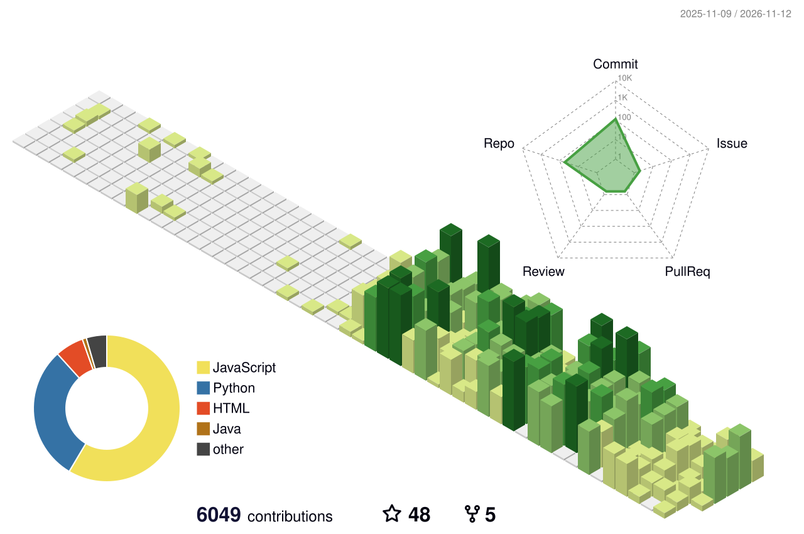
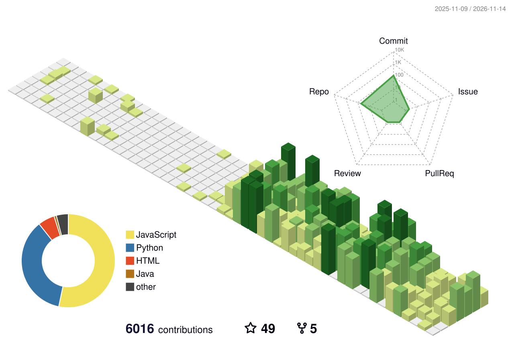
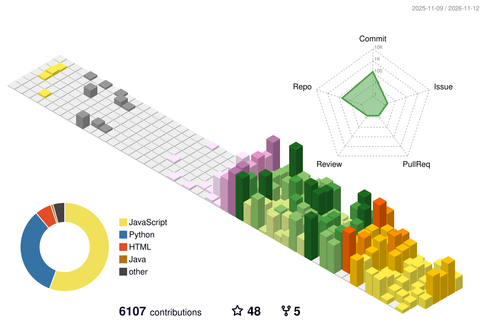
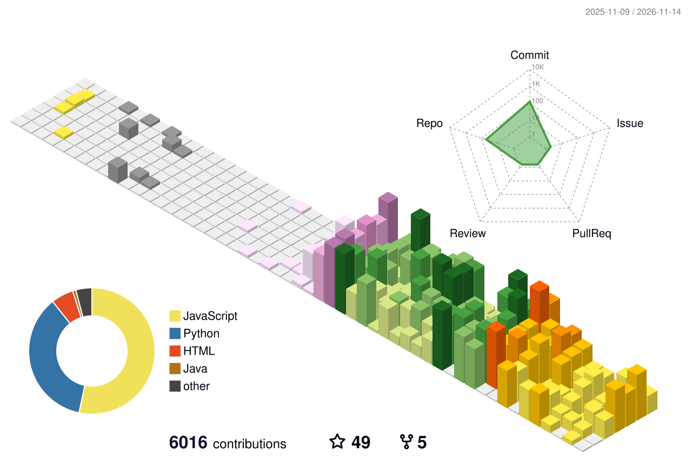
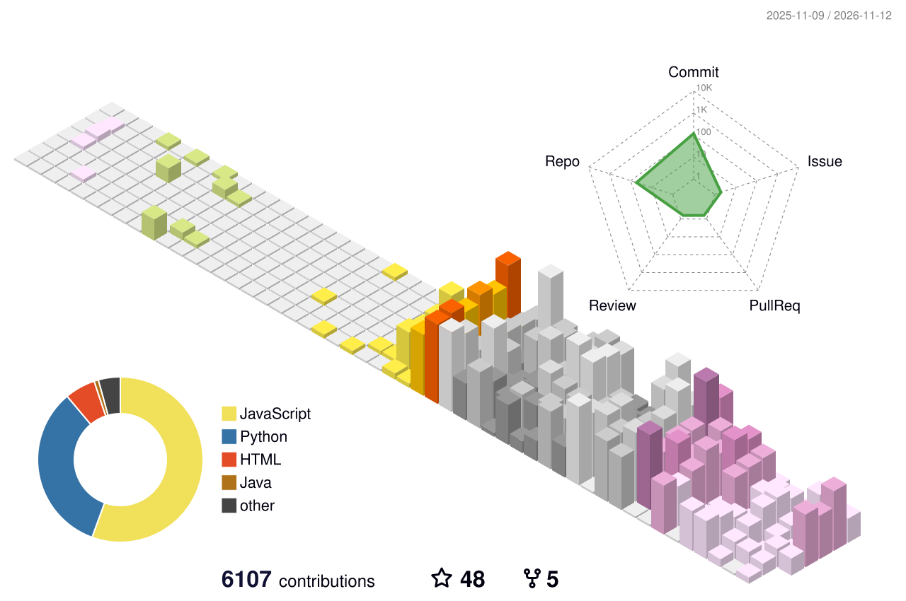
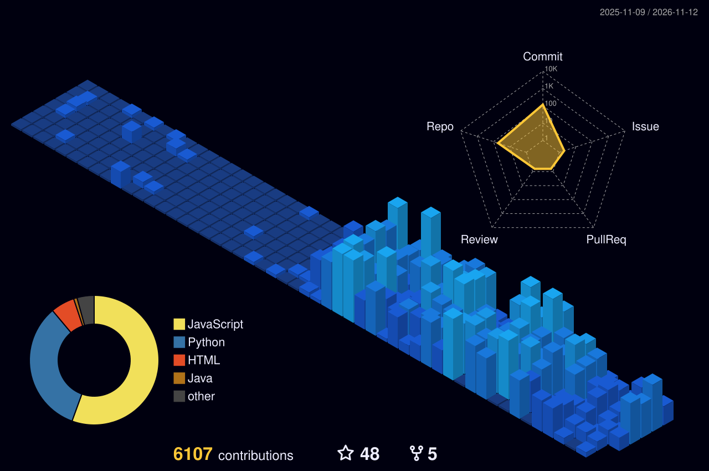
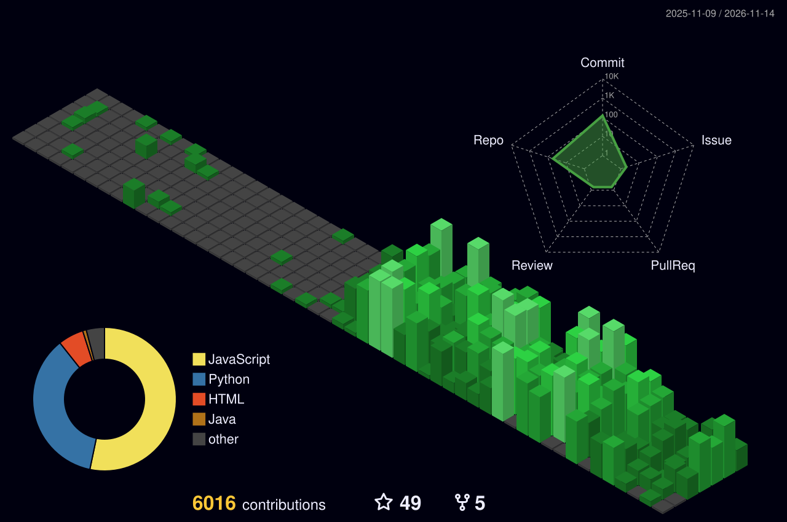
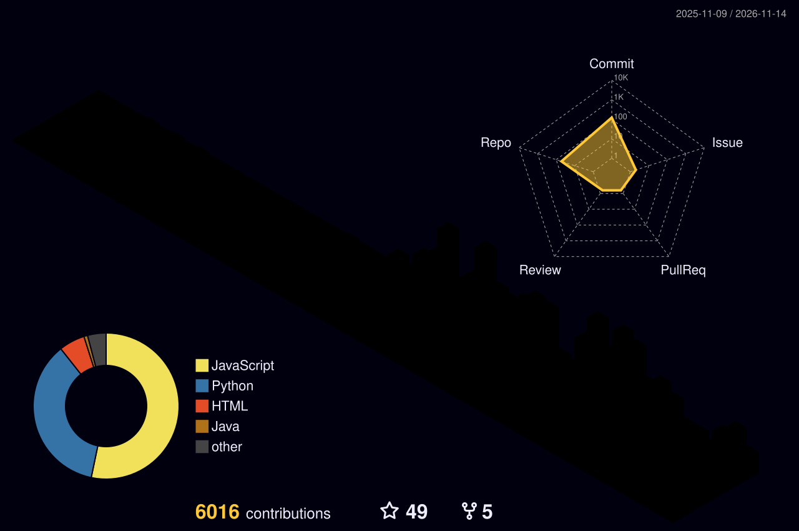
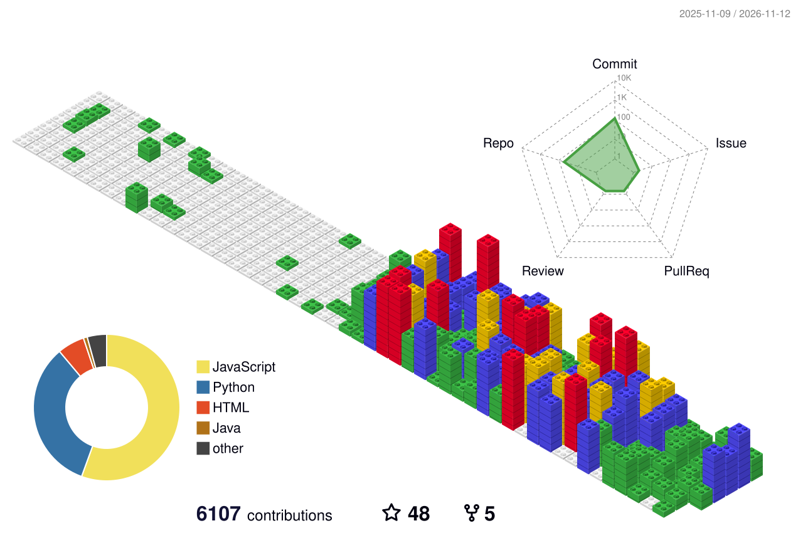

<!-- 由 scripts/render_profile.py 生成。 -->
# 3D 贡献日历

[贡献动画](README.md) · [效果库](../README.md) · [个人主页](../../README.md)

示例账号 [haers](https://github.com/haers)。

## 绿色日历



```markdown

```

## 绿色动画



```markdown

```

## 四季配色



```markdown

```

## 四季动画



```markdown

```

## 南半球四季



```markdown

```

## 南半球四季动画


```markdown

```

## 夜景



```markdown

```

## 夜间绿色



```markdown

```

## 夜间彩虹



```markdown

```

## 积木



```markdown

```

## 工作流

```yaml
name: generate-3d-green
on:
  workflow_dispatch:
  schedule:
    - cron: '15 0 * * *'
  push:
    branches: [main]
permissions:
  contents: write
concurrency:
  group: generate-3d-green
  cancel-in-progress: false
jobs:
  generate:
    runs-on: ubuntu-latest
    timeout-minutes: 12
    steps:
      - uses: actions/checkout@v5
      - uses: yoshi389111/github-profile-3d-contrib@7d95e7d4cdc028dd1e1cbd957d65f35efb12ae39
        env:
          GITHUB_TOKEN: ${{ secrets.GITHUB_TOKEN }}
          USERNAME: ${{ github.repository_owner }}
      - name: Collect and publish
        shell: bash
        run: |
          set -euo pipefail
          mkdir -p static/effects
          cp profile-3d-contrib/profile-green.svg static/effects/profile-green.svg
          cp profile-3d-contrib/profile-green-animate.svg static/effects/profile-green-animate.svg
          cp profile-3d-contrib/profile-season.svg static/effects/profile-season.svg
          cp profile-3d-contrib/profile-season-animate.svg static/effects/profile-season-animate.svg
          cp profile-3d-contrib/profile-south-season.svg static/effects/profile-south-season.svg
          cp profile-3d-contrib/profile-south-season-animate.svg static/effects/profile-south-season-animate.svg
          cp profile-3d-contrib/profile-night-view.svg static/effects/profile-night-view.svg
          cp profile-3d-contrib/profile-night-green.svg static/effects/profile-night-green.svg
          cp profile-3d-contrib/profile-night-rainbow.svg static/effects/profile-night-rainbow.svg
          cp profile-3d-contrib/profile-gitblock.svg static/effects/profile-gitblock.svg
          python3 - <<'PYTHON'
          from pathlib import Path
          import xml.etree.ElementTree as ET
          for name in ['static/effects/profile-green.svg', 'static/effects/profile-green-animate.svg', 'static/effects/profile-season.svg', 'static/effects/profile-season-animate.svg', 'static/effects/profile-south-season.svg', 'static/effects/profile-south-season-animate.svg', 'static/effects/profile-night-view.svg', 'static/effects/profile-night-green.svg', 'static/effects/profile-night-rainbow.svg', 'static/effects/profile-gitblock.svg']:
              path = Path(name)
              text = '\n'.join(line.rstrip() for line in path.read_text().splitlines()) + '\n'
              ET.fromstring(text)
              path.write_text(text)
          PYTHON
          git add -- static/effects/profile-green.svg static/effects/profile-green-animate.svg static/effects/profile-season.svg static/effects/profile-season-animate.svg static/effects/profile-south-season.svg static/effects/profile-south-season-animate.svg static/effects/profile-night-view.svg static/effects/profile-night-green.svg static/effects/profile-night-rainbow.svg static/effects/profile-gitblock.svg
          if git diff --cached --quiet; then
            exit 0
          fi
          git diff --cached --check
          git config user.name 'github-actions[bot]'
          git config user.email '41898282+github-actions[bot]@users.noreply.github.com'
          git commit -m 'chore: update contribution graph'
          git push --dry-run origin HEAD:main
          git push origin HEAD:main
```

---

[GitHub Profile 3D Contrib](https://github.com/yoshi389111/github-profile-3d-contrib)
