<!-- 由 scripts/render_profile.py 生成。 -->

# 贡献动画

[效果库](../README.md) · [个人主页](../../README.md) · [查看源码](https://github.com/haers/haers/blob/main/examples/contributions/README.md?plain=1)

[街机动画](#街机动画) · [3D 日历](#3d-日历) · [贡献贪吃蛇](#贡献贪吃蛇)

示例账号 [haers](https://github.com/haers)。

## 街机动画

### 吃豆人

<picture>
  <source media="(prefers-color-scheme: dark)" srcset="https://raw.githubusercontent.com/haers/haers/main/static/effects/pacman-dark.svg" />
  
</picture>

### 打砖块

<picture>
  <source media="(prefers-color-scheme: dark)" srcset="https://raw.githubusercontent.com/haers/haers/main/static/effects/breakout-dark.svg" />
  
</picture>

### 太空射击

<picture>
  <source media="(prefers-color-scheme: dark)" srcset="https://raw.githubusercontent.com/haers/haers/main/static/effects/galaga-dark.svg" />
  
</picture>

### 泡泡龙

<picture>
  <source media="(prefers-color-scheme: dark)" srcset="https://raw.githubusercontent.com/haers/haers/main/static/effects/puzzle-bobble-dark.svg" />
  
</picture>

### 炸弹人

<picture>
  <source media="(prefers-color-scheme: dark)" srcset="https://raw.githubusercontent.com/haers/haers/main/static/effects/bomberman-dark.svg" />
  
</picture>

### 扫雷

<picture>
  <source media="(prefers-color-scheme: dark)" srcset="https://raw.githubusercontent.com/haers/haers/main/static/effects/minesweeper-dark.svg" />
  
</picture>

### 街机贪吃蛇

<picture>
  <source media="(prefers-color-scheme: dark)" srcset="https://raw.githubusercontent.com/haers/haers/main/static/effects/snake-dark.svg" />
  
</picture>

### 俄罗斯方块

<picture>
  <source media="(prefers-color-scheme: dark)" srcset="https://raw.githubusercontent.com/haers/haers/main/static/effects/tetris-dark.svg" />
  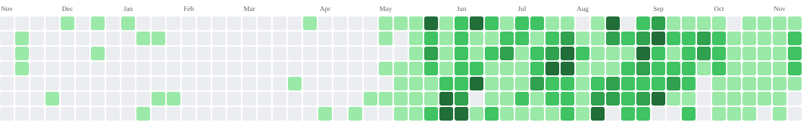
</picture>

## 3D 日历

### 绿色日历

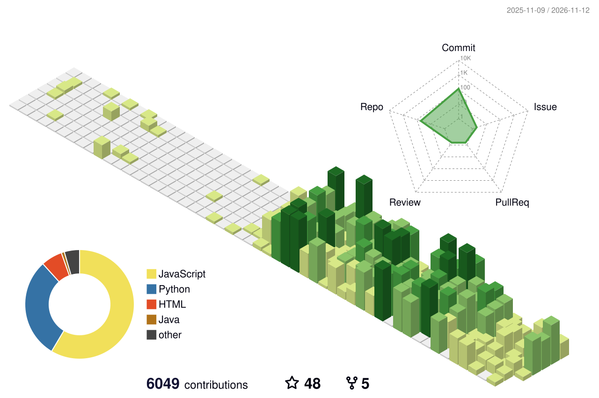

### 绿色动画

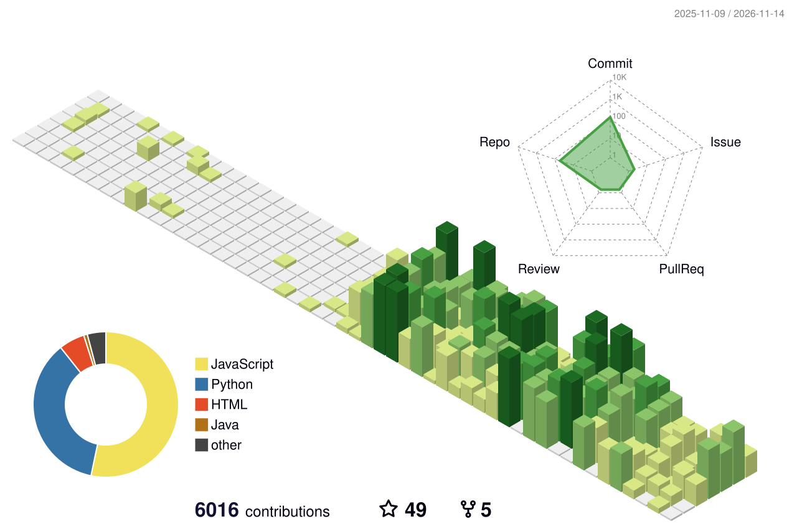

### 四季配色

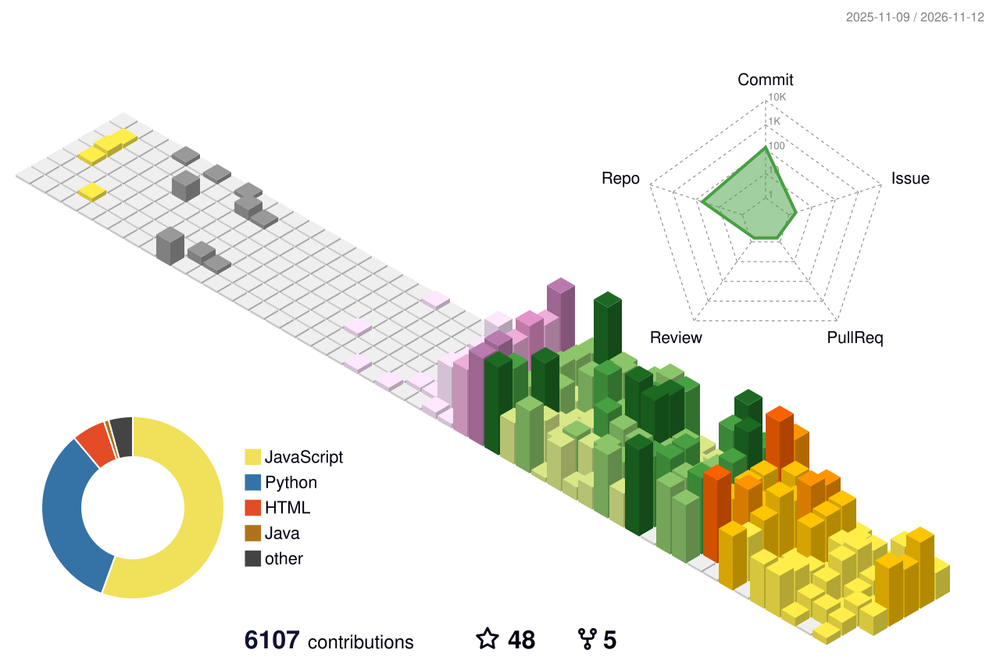

### 四季动画

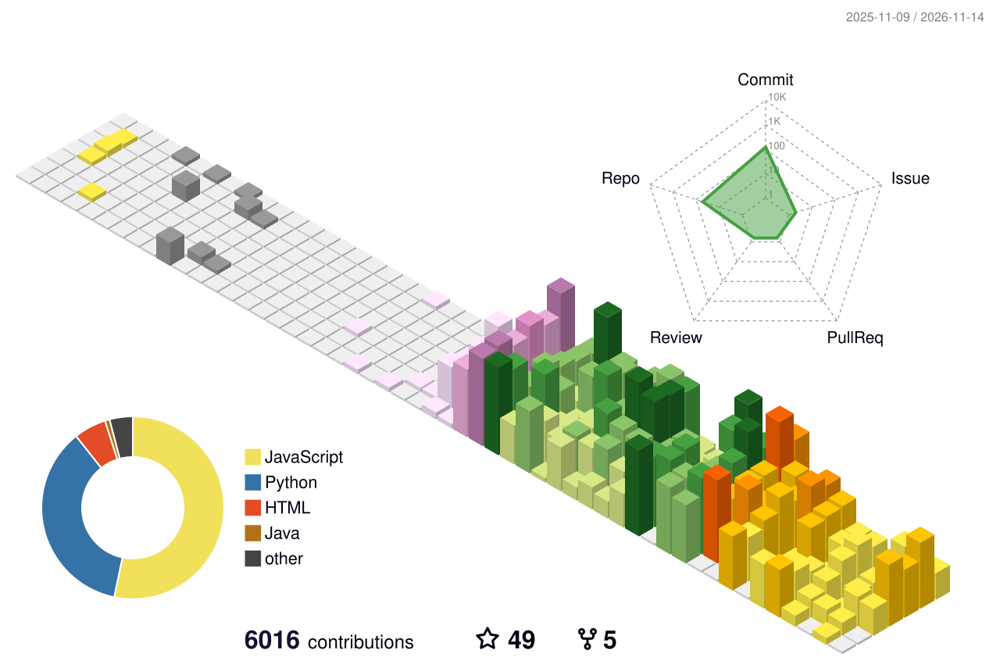

### 南半球四季

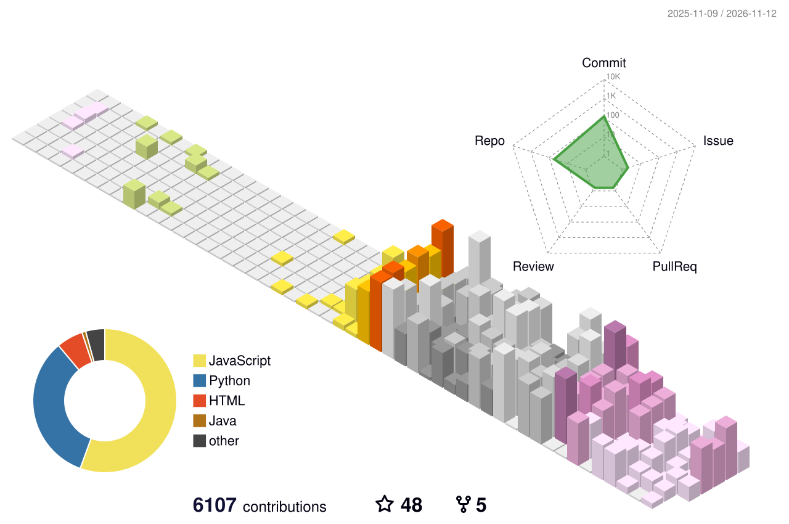

### 南半球四季动画

### 夜景

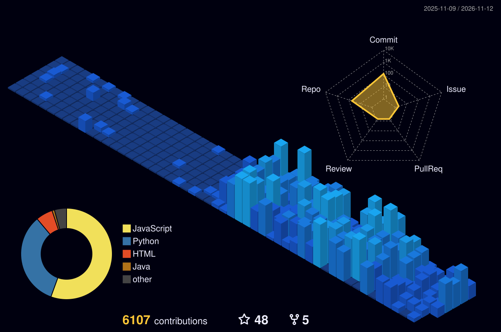

### 夜间绿色

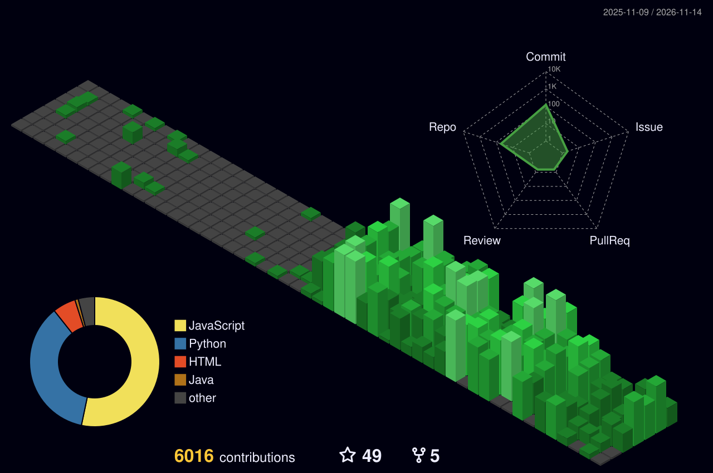

### 夜间彩虹

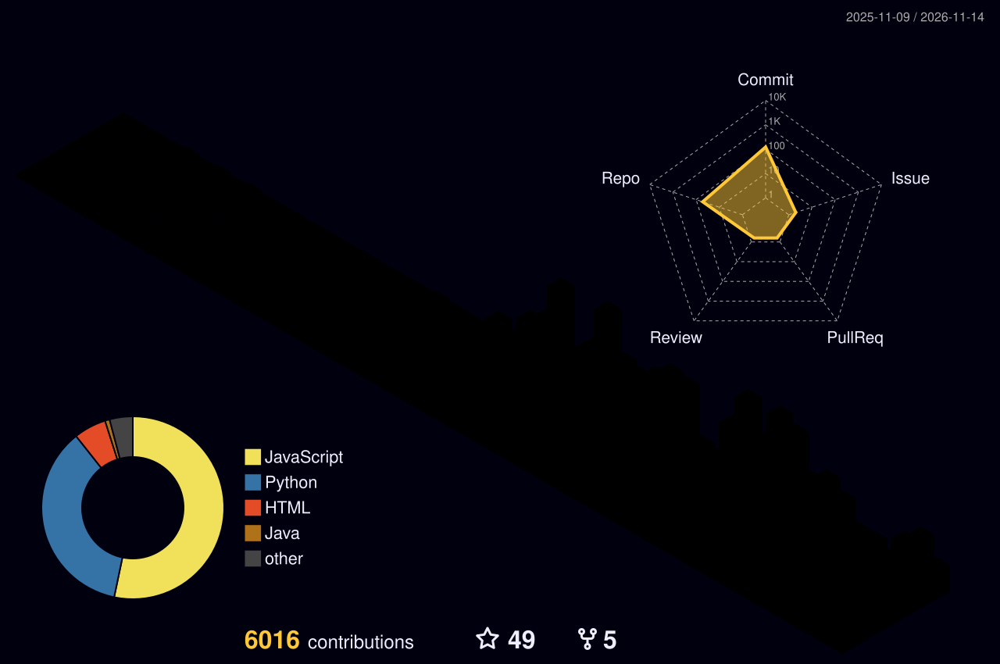

### 积木

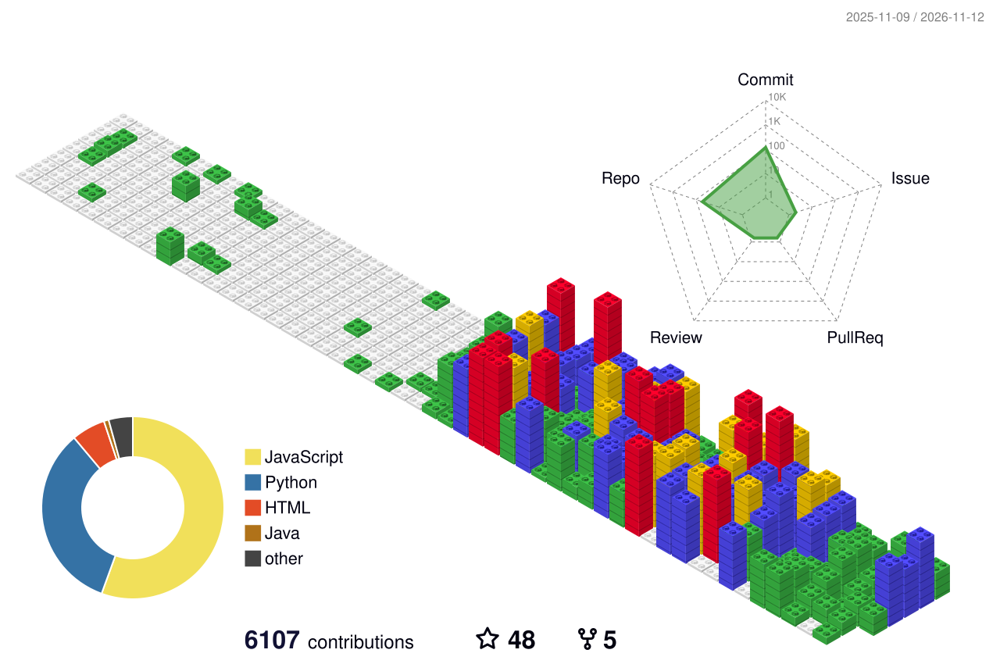

## 贡献贪吃蛇

### 明暗主题

<picture>
  <source media="(prefers-color-scheme: dark)" srcset="https://raw.githubusercontent.com/haers/haers/main/github-contribution-snake/github-contribution-grid-snake-dark.svg" />
  
</picture>

---

[街机动画](https://github.com/abozanona/pacman-contribution-graph) · [3D 日历](https://github.com/yoshi389111/github-profile-3d-contrib) · [snk](https://github.com/Platane/snk) · [街机与日历工作流](../../.github/workflows/effects.yml) · [贪吃蛇工作流](../../.github/workflows/snk.yml)
