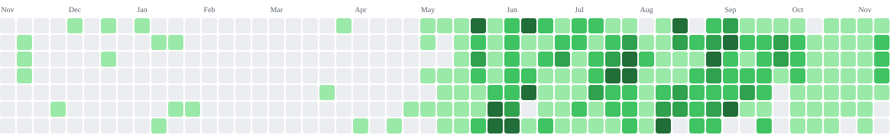

<!-- 由 scripts/render_profile.py 生成。 -->
# 街机贡献动画

[贡献动画](README.md) · [效果库](../README.md) · [个人主页](../../README.md)

示例账号 [haers](https://github.com/haers)。

## 吃豆人

<picture>
  <source media="(prefers-color-scheme: dark)" srcset="https://raw.githubusercontent.com/haers/haers/main/static/effects/pacman-dark.svg" />
  
</picture>

```html
<picture>
  <source media="(prefers-color-scheme: dark)" srcset="https://raw.githubusercontent.com/haers/haers/main/static/effects/pacman-dark.svg" />
  
</picture>
```

### 工作流

```yaml
name: generate-pacman-pacman
on:
  workflow_dispatch:
  schedule:
    - cron: '15 0 * * *'
  push:
    branches: [main]
permissions:
  contents: write
concurrency:
  group: generate-pacman-pacman
  cancel-in-progress: false
jobs:
  generate:
    runs-on: ubuntu-latest
    timeout-minutes: 12
    steps:
      - uses: actions/checkout@v5
      - uses: abozanona/pacman-contribution-graph@70945878b1118303b37b88060fc7145e1a57d7b1
        with:
          github_user_name: ${{ github.repository_owner }}
          games: pacman
      - name: Collect and publish
        shell: bash
        run: |
          set -euo pipefail
          mkdir -p static/effects
          cp dist/pacman-contribution-graph.svg static/effects/pacman.svg
          cp dist/pacman-contribution-graph-dark.svg static/effects/pacman-dark.svg
          python3 - <<'PYTHON'
          from pathlib import Path
          import xml.etree.ElementTree as ET
          for name in ['static/effects/pacman.svg', 'static/effects/pacman-dark.svg']:
              path = Path(name)
              text = '\n'.join(line.rstrip() for line in path.read_text().splitlines()) + '\n'
              ET.fromstring(text)
              path.write_text(text)
          PYTHON
          git add -- static/effects/pacman.svg static/effects/pacman-dark.svg
          if git diff --cached --quiet; then
            exit 0
          fi
          git diff --cached --check
          git config user.name 'github-actions[bot]'
          git config user.email '41898282+github-actions[bot]@users.noreply.github.com'
          git commit -m 'chore: update contribution graph'
          git push --dry-run origin HEAD:main
          git push origin HEAD:main
```

## 打砖块

<picture>
  <source media="(prefers-color-scheme: dark)" srcset="https://raw.githubusercontent.com/haers/haers/main/static/effects/breakout-dark.svg" />
  
</picture>

```html
<picture>
  <source media="(prefers-color-scheme: dark)" srcset="https://raw.githubusercontent.com/haers/haers/main/static/effects/breakout-dark.svg" />
  
</picture>
```

### 工作流

```yaml
name: generate-pacman-breakout
on:
  workflow_dispatch:
  schedule:
    - cron: '15 0 * * *'
  push:
    branches: [main]
permissions:
  contents: write
concurrency:
  group: generate-pacman-breakout
  cancel-in-progress: false
jobs:
  generate:
    runs-on: ubuntu-latest
    timeout-minutes: 12
    steps:
      - uses: actions/checkout@v5
      - uses: abozanona/pacman-contribution-graph@70945878b1118303b37b88060fc7145e1a57d7b1
        with:
          github_user_name: ${{ github.repository_owner }}
          games: breakout
      - name: Collect and publish
        shell: bash
        run: |
          set -euo pipefail
          mkdir -p static/effects
          cp dist/breakout-contribution-graph.svg static/effects/breakout.svg
          cp dist/breakout-contribution-graph-dark.svg static/effects/breakout-dark.svg
          python3 - <<'PYTHON'
          from pathlib import Path
          import xml.etree.ElementTree as ET
          for name in ['static/effects/breakout.svg', 'static/effects/breakout-dark.svg']:
              path = Path(name)
              text = '\n'.join(line.rstrip() for line in path.read_text().splitlines()) + '\n'
              ET.fromstring(text)
              path.write_text(text)
          PYTHON
          git add -- static/effects/breakout.svg static/effects/breakout-dark.svg
          if git diff --cached --quiet; then
            exit 0
          fi
          git diff --cached --check
          git config user.name 'github-actions[bot]'
          git config user.email '41898282+github-actions[bot]@users.noreply.github.com'
          git commit -m 'chore: update contribution graph'
          git push --dry-run origin HEAD:main
          git push origin HEAD:main
```

## 太空射击

<picture>
  <source media="(prefers-color-scheme: dark)" srcset="https://raw.githubusercontent.com/haers/haers/main/static/effects/galaga-dark.svg" />
  
</picture>

```html
<picture>
  <source media="(prefers-color-scheme: dark)" srcset="https://raw.githubusercontent.com/haers/haers/main/static/effects/galaga-dark.svg" />
  
</picture>
```

### 工作流

```yaml
name: generate-pacman-galaga
on:
  workflow_dispatch:
  schedule:
    - cron: '15 0 * * *'
  push:
    branches: [main]
permissions:
  contents: write
concurrency:
  group: generate-pacman-galaga
  cancel-in-progress: false
jobs:
  generate:
    runs-on: ubuntu-latest
    timeout-minutes: 12
    steps:
      - uses: actions/checkout@v5
      - uses: abozanona/pacman-contribution-graph@70945878b1118303b37b88060fc7145e1a57d7b1
        with:
          github_user_name: ${{ github.repository_owner }}
          games: galaga
      - name: Collect and publish
        shell: bash
        run: |
          set -euo pipefail
          mkdir -p static/effects
          cp dist/galaga-contribution-graph.svg static/effects/galaga.svg
          cp dist/galaga-contribution-graph-dark.svg static/effects/galaga-dark.svg
          python3 - <<'PYTHON'
          from pathlib import Path
          import xml.etree.ElementTree as ET
          for name in ['static/effects/galaga.svg', 'static/effects/galaga-dark.svg']:
              path = Path(name)
              text = '\n'.join(line.rstrip() for line in path.read_text().splitlines()) + '\n'
              ET.fromstring(text)
              path.write_text(text)
          PYTHON
          git add -- static/effects/galaga.svg static/effects/galaga-dark.svg
          if git diff --cached --quiet; then
            exit 0
          fi
          git diff --cached --check
          git config user.name 'github-actions[bot]'
          git config user.email '41898282+github-actions[bot]@users.noreply.github.com'
          git commit -m 'chore: update contribution graph'
          git push --dry-run origin HEAD:main
          git push origin HEAD:main
```

## 泡泡龙

<picture>
  <source media="(prefers-color-scheme: dark)" srcset="https://raw.githubusercontent.com/haers/haers/main/static/effects/puzzle-bobble-dark.svg" />
  
</picture>

```html
<picture>
  <source media="(prefers-color-scheme: dark)" srcset="https://raw.githubusercontent.com/haers/haers/main/static/effects/puzzle-bobble-dark.svg" />
  
</picture>
```

### 工作流

```yaml
name: generate-pacman-puzzle-bobble
on:
  workflow_dispatch:
  schedule:
    - cron: '15 0 * * *'
  push:
    branches: [main]
permissions:
  contents: write
concurrency:
  group: generate-pacman-puzzle-bobble
  cancel-in-progress: false
jobs:
  generate:
    runs-on: ubuntu-latest
    timeout-minutes: 12
    steps:
      - uses: actions/checkout@v5
      - uses: abozanona/pacman-contribution-graph@70945878b1118303b37b88060fc7145e1a57d7b1
        with:
          github_user_name: ${{ github.repository_owner }}
          games: puzzle-bobble
      - name: Collect and publish
        shell: bash
        run: |
          set -euo pipefail
          mkdir -p static/effects
          cp dist/puzzle-bobble-contribution-graph.svg static/effects/puzzle-bobble.svg
          cp dist/puzzle-bobble-contribution-graph-dark.svg static/effects/puzzle-bobble-dark.svg
          python3 - <<'PYTHON'
          from pathlib import Path
          import xml.etree.ElementTree as ET
          for name in ['static/effects/puzzle-bobble.svg', 'static/effects/puzzle-bobble-dark.svg']:
              path = Path(name)
              text = '\n'.join(line.rstrip() for line in path.read_text().splitlines()) + '\n'
              ET.fromstring(text)
              path.write_text(text)
          PYTHON
          git add -- static/effects/puzzle-bobble.svg static/effects/puzzle-bobble-dark.svg
          if git diff --cached --quiet; then
            exit 0
          fi
          git diff --cached --check
          git config user.name 'github-actions[bot]'
          git config user.email '41898282+github-actions[bot]@users.noreply.github.com'
          git commit -m 'chore: update contribution graph'
          git push --dry-run origin HEAD:main
          git push origin HEAD:main
```

## 炸弹人

<picture>
  <source media="(prefers-color-scheme: dark)" srcset="https://raw.githubusercontent.com/haers/haers/main/static/effects/bomberman-dark.svg" />
  
</picture>

```html
<picture>
  <source media="(prefers-color-scheme: dark)" srcset="https://raw.githubusercontent.com/haers/haers/main/static/effects/bomberman-dark.svg" />
  
</picture>
```

### 工作流

```yaml
name: generate-pacman-bomberman
on:
  workflow_dispatch:
  schedule:
    - cron: '15 0 * * *'
  push:
    branches: [main]
permissions:
  contents: write
concurrency:
  group: generate-pacman-bomberman
  cancel-in-progress: false
jobs:
  generate:
    runs-on: ubuntu-latest
    timeout-minutes: 12
    steps:
      - uses: actions/checkout@v5
      - uses: abozanona/pacman-contribution-graph@70945878b1118303b37b88060fc7145e1a57d7b1
        with:
          github_user_name: ${{ github.repository_owner }}
          games: bomberman
      - name: Collect and publish
        shell: bash
        run: |
          set -euo pipefail
          mkdir -p static/effects
          cp dist/bomberman-contribution-graph.svg static/effects/bomberman.svg
          cp dist/bomberman-contribution-graph-dark.svg static/effects/bomberman-dark.svg
          python3 - <<'PYTHON'
          from pathlib import Path
          import xml.etree.ElementTree as ET
          for name in ['static/effects/bomberman.svg', 'static/effects/bomberman-dark.svg']:
              path = Path(name)
              text = '\n'.join(line.rstrip() for line in path.read_text().splitlines()) + '\n'
              ET.fromstring(text)
              path.write_text(text)
          PYTHON
          git add -- static/effects/bomberman.svg static/effects/bomberman-dark.svg
          if git diff --cached --quiet; then
            exit 0
          fi
          git diff --cached --check
          git config user.name 'github-actions[bot]'
          git config user.email '41898282+github-actions[bot]@users.noreply.github.com'
          git commit -m 'chore: update contribution graph'
          git push --dry-run origin HEAD:main
          git push origin HEAD:main
```

## 扫雷

<picture>
  <source media="(prefers-color-scheme: dark)" srcset="https://raw.githubusercontent.com/haers/haers/main/static/effects/minesweeper-dark.svg" />
  
</picture>

```html
<picture>
  <source media="(prefers-color-scheme: dark)" srcset="https://raw.githubusercontent.com/haers/haers/main/static/effects/minesweeper-dark.svg" />
  
</picture>
```

### 工作流

```yaml
name: generate-pacman-minesweeper
on:
  workflow_dispatch:
  schedule:
    - cron: '15 0 * * *'
  push:
    branches: [main]
permissions:
  contents: write
concurrency:
  group: generate-pacman-minesweeper
  cancel-in-progress: false
jobs:
  generate:
    runs-on: ubuntu-latest
    timeout-minutes: 12
    steps:
      - uses: actions/checkout@v5
      - uses: abozanona/pacman-contribution-graph@70945878b1118303b37b88060fc7145e1a57d7b1
        with:
          github_user_name: ${{ github.repository_owner }}
          games: minesweeper
      - name: Collect and publish
        shell: bash
        run: |
          set -euo pipefail
          mkdir -p static/effects
          cp dist/minesweeper-contribution-graph.svg static/effects/minesweeper.svg
          cp dist/minesweeper-contribution-graph-dark.svg static/effects/minesweeper-dark.svg
          python3 - <<'PYTHON'
          from pathlib import Path
          import xml.etree.ElementTree as ET
          for name in ['static/effects/minesweeper.svg', 'static/effects/minesweeper-dark.svg']:
              path = Path(name)
              text = '\n'.join(line.rstrip() for line in path.read_text().splitlines()) + '\n'
              ET.fromstring(text)
              path.write_text(text)
          PYTHON
          git add -- static/effects/minesweeper.svg static/effects/minesweeper-dark.svg
          if git diff --cached --quiet; then
            exit 0
          fi
          git diff --cached --check
          git config user.name 'github-actions[bot]'
          git config user.email '41898282+github-actions[bot]@users.noreply.github.com'
          git commit -m 'chore: update contribution graph'
          git push --dry-run origin HEAD:main
          git push origin HEAD:main
```

## 街机贪吃蛇

<picture>
  <source media="(prefers-color-scheme: dark)" srcset="https://raw.githubusercontent.com/haers/haers/main/static/effects/snake-dark.svg" />
  
</picture>

```html
<picture>
  <source media="(prefers-color-scheme: dark)" srcset="https://raw.githubusercontent.com/haers/haers/main/static/effects/snake-dark.svg" />
  
</picture>
```

### 工作流

```yaml
name: generate-pacman-snake
on:
  workflow_dispatch:
  schedule:
    - cron: '15 0 * * *'
  push:
    branches: [main]
permissions:
  contents: write
concurrency:
  group: generate-pacman-snake
  cancel-in-progress: false
jobs:
  generate:
    runs-on: ubuntu-latest
    timeout-minutes: 12
    steps:
      - uses: actions/checkout@v5
      - uses: abozanona/pacman-contribution-graph@70945878b1118303b37b88060fc7145e1a57d7b1
        with:
          github_user_name: ${{ github.repository_owner }}
          games: snake
      - name: Collect and publish
        shell: bash
        run: |
          set -euo pipefail
          mkdir -p static/effects
          cp dist/snake-contribution-graph.svg static/effects/snake.svg
          cp dist/snake-contribution-graph-dark.svg static/effects/snake-dark.svg
          python3 - <<'PYTHON'
          from pathlib import Path
          import xml.etree.ElementTree as ET
          for name in ['static/effects/snake.svg', 'static/effects/snake-dark.svg']:
              path = Path(name)
              text = '\n'.join(line.rstrip() for line in path.read_text().splitlines()) + '\n'
              ET.fromstring(text)
              path.write_text(text)
          PYTHON
          git add -- static/effects/snake.svg static/effects/snake-dark.svg
          if git diff --cached --quiet; then
            exit 0
          fi
          git diff --cached --check
          git config user.name 'github-actions[bot]'
          git config user.email '41898282+github-actions[bot]@users.noreply.github.com'
          git commit -m 'chore: update contribution graph'
          git push --dry-run origin HEAD:main
          git push origin HEAD:main
```

## 俄罗斯方块

<picture>
  <source media="(prefers-color-scheme: dark)" srcset="https://raw.githubusercontent.com/haers/haers/main/static/effects/tetris-dark.svg" />
  
</picture>

```html
<picture>
  <source media="(prefers-color-scheme: dark)" srcset="https://raw.githubusercontent.com/haers/haers/main/static/effects/tetris-dark.svg" />
  
</picture>
```

### 工作流

```yaml
name: generate-pacman-tetris
on:
  workflow_dispatch:
  schedule:
    - cron: '15 0 * * *'
  push:
    branches: [main]
permissions:
  contents: write
concurrency:
  group: generate-pacman-tetris
  cancel-in-progress: false
jobs:
  generate:
    runs-on: ubuntu-latest
    timeout-minutes: 12
    steps:
      - uses: actions/checkout@v5
      - uses: abozanona/pacman-contribution-graph@70945878b1118303b37b88060fc7145e1a57d7b1
        with:
          github_user_name: ${{ github.repository_owner }}
          games: tetris
      - name: Collect and publish
        shell: bash
        run: |
          set -euo pipefail
          mkdir -p static/effects
          cp dist/tetris-contribution-graph.svg static/effects/tetris.svg
          cp dist/tetris-contribution-graph-dark.svg static/effects/tetris-dark.svg
          python3 - <<'PYTHON'
          from pathlib import Path
          import xml.etree.ElementTree as ET
          for name in ['static/effects/tetris.svg', 'static/effects/tetris-dark.svg']:
              path = Path(name)
              text = '\n'.join(line.rstrip() for line in path.read_text().splitlines()) + '\n'
              ET.fromstring(text)
              path.write_text(text)
          PYTHON
          git add -- static/effects/tetris.svg static/effects/tetris-dark.svg
          if git diff --cached --quiet; then
            exit 0
          fi
          git diff --cached --check
          git config user.name 'github-actions[bot]'
          git config user.email '41898282+github-actions[bot]@users.noreply.github.com'
          git commit -m 'chore: update contribution graph'
          git push --dry-run origin HEAD:main
          git push origin HEAD:main
```

---

[Pac-Man Contribution Graph](https://github.com/abozanona/pacman-contribution-graph)
